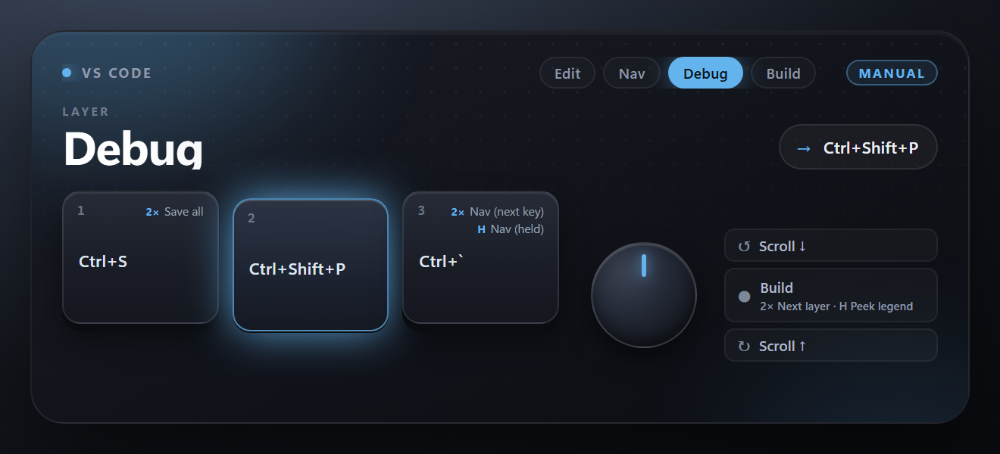
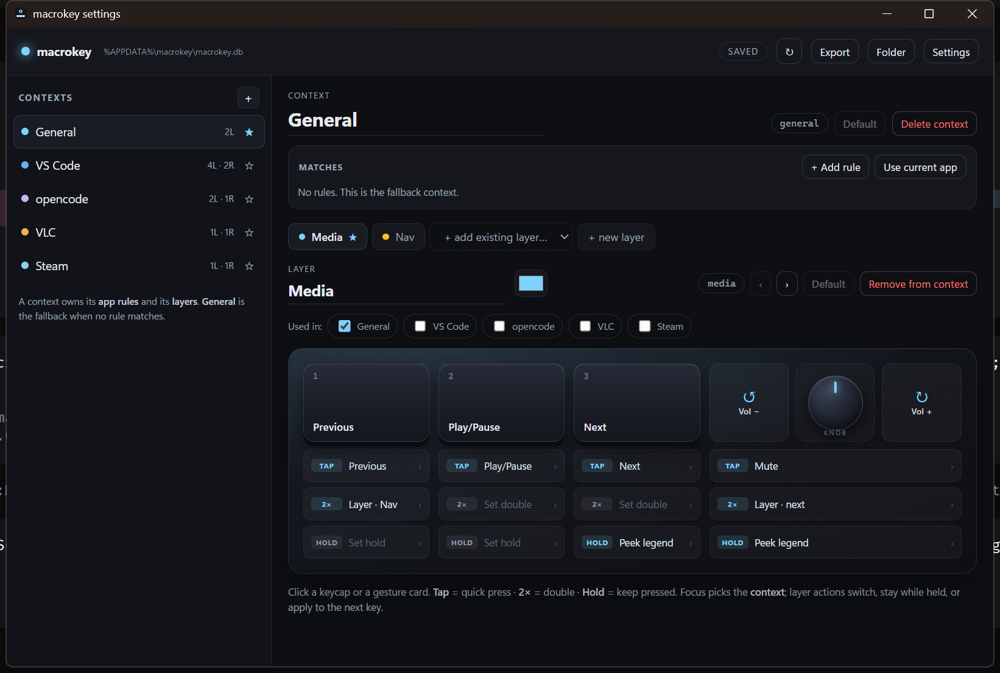

# macrokey

**Context-aware layers, gestures and an on-screen legend for a cheap 3-key + 1-knob CH57x macropad.**

The pad is flashed **once** to emit the phantom keys `F13`–`F18`. A small Windows
host agent maps the focused app to a **context**, the context to a **layer**, and
each key's **tap / double / hold** to a real action. Everything — contexts,
layers, bindings, rules, OSD settings — is data in local SQLite, edited from the
tray's Settings window.

No custom firmware. No cloud. No telemetry. No background keyboard logger: Raw
Input is filtered to the pad's USB device.

<p align="center">
  
</p>

<p align="center">
  
</p>

## Status

v0.1 public prototype. Windows 10/11 x64, WebView2, and **only** the
`1189:8890` 3-key + 1-knob CH57x board with the provided firmware profile. On
Windows 10, install the WebView2 Evergreen Runtime if it is not already present.

The app is intentionally small and local. It is not yet code-signed, does not
have an installer, autostart or auto-updater, and the schema has no migration
framework. Read [docs/review.md](docs/review.md) for the full readiness review
and [PUBLISHING.md](PUBLISHING.md) for the release checklist. Changes are listed
in [CHANGELOG.md](CHANGELOG.md).

## Quick start

1. **Flash the pad once** with
   [`config/pad-single-layer.yaml`](config/pad-single-layer.yaml) using
   `ch57x-keyboard-tool` and USBDK. See [Flashing](#flashing-the-phantom-key-profile).
2. **Download `macrokey-agent.exe`** from the repository's Releases page, or
   build it from source (below).
3. **Run it.** On first launch it opens **Settings** so the tray-only app is not
   invisible. After that, use the tray icon: **Settings…**, **Show current
   layer**, **Quit**.
4. **Create contexts and layers**, then click a keycap or gesture card under the
   pad deck. Every edit auto-saves to
   `%APPDATA%\macrokey\macrokey.db`; the engine reloads within ~600 ms.

If Settings is closed it hides to the tray. The tray icon is also the live status
light: its colour is the active layer's colour, and its tooltip reads
`macrokey · <context> · <layer>`.

### Build from source

```powershell
cd agent\src-tauri
cargo build --release
# agent\src-tauri\target\release\macrokey-agent.exe
```

Development loop and tests:

```powershell
cargo run          # first launch opens Settings
cargo test
cargo clippy --all-targets -- -D warnings
```

## What you get

- **Contexts, not just layers.** A context is an environment (`General`,
  `VS Code`, `opencode`, `VLC`, `Steam`, …). Rules match the focused process,
  window title (regex) or class; first match wins, `General` is the fallback.
- **A context owns an ordered layer list and a default layer.** VS Code might be
  `Edit` → `Nav` → `Debug` → `Build`. Layers are a **shared library**, so `Nav`
  is the same layer everywhere.
- **Three gestures per input.** Key 1–3 and knob press support `tap`, `double`
  and `hold`; knob rotation supports tap with an acceleration multiplier. The HUD
  shows the tap as the main label and `2×` / `H` sublines.
- **Layer transitions.** Switch, one-shot (next key only), momentary (while
  held), next/previous inside the context, and back to the context default.
- **Real actions.** Chords, key sequences, Unicode text, media keys, wheel
  scrolling, launch app/file, URL, `cmd /C` script, minimize/maximize/restore/
  close the foreground window, peek the legend, or nothing.
- **Physical-pad HUD.** The keycap or knob segment depresses, ripples and shows
  the action that actually ran. The layer rail and hero layer name animate on a
  layer change. The HUD does **not** pop on context switches or config saves.
- **Physical-pad settings deck.** Three keycaps plus a spatial knob cluster
  (**CCW card · knob · CW card**), with `TAP` / `2×` / `HOLD` cards underneath and
  a Matches modal for rules.

## How it works

```
Raw Input (pad only) ─┐
focus watcher ────────┴─> context -> layer -> binding -> SendInput / launch
                                      │
                                      └─> OSD (click-through, context · layer)
                                      └─> tray icon colour + tooltip
```

The pad is deliberately dumb: key 1–3 and knob press/CCW/CW emit `F13`–`F18`.
The host owns the real state. If the agent is not running the pad still emits
those keys; most apps ignore them, and nothing is bricked or left in a weird
state.

Everything is persisted in SQLite:

```
contexts(id, label, default_layer, position)
layers(id, label, color, position)
context_layers(context_id, layer_id, position)
bindings(layer_id, input, gesture, action)   -- action is JSON
rules(position, process, title, class, context_id)
settings(id=1, json)                         -- pad, gestures, knob, OSD
meta(key, value)                             -- schema, revision
```

The agent watches `meta.revision` and reloads within ~600 ms. YAML is only the
seed for a fresh database and the export/backup format. The seed is embedded in
the executable, so the release is a single portable binary.

## Flashing the phantom-key profile

Requires [`ch57x-keyboard-tool`](https://github.com/kriomant/ch57x-keyboard-tool)
and [USBDK](https://github.com/daynix/UsbDk/releases) on Windows.

```powershell
ch57x-keyboard-tool validate config/pad-single-layer.yaml
ch57x-keyboard-tool upload   config/pad-single-layer.yaml
```

Then verify with the Raw Input logger (left to right, then knob):

```powershell
python tools/rawinput_log.py -s 60
```

Expected: `F13`, `F14`, `F15`, and `F17` / `F16` / `F18` for the knob, each with
a `DOWN` and an `UP`, all from the pad's device path.

| Input | Sends |
|---|---|
| key 1 (left) | `F13` |
| key 2 (middle) | `F14` |
| key 3 (right) | `F15` |
| knob press | `F16` |
| knob CCW | `F17` |
| knob CW | `F18` |

> Flashing replaces the current keymap. The current one is not readable over
> USB, so note down anything you care about before writing. Running the capture
> once (see [docs/experiments.md](docs/experiments.md), E1) recovers it
> indirectly from the keys it types.

## Background: the investigation

The pad is a composite HID device with no USB strings and a `ch57x-2` config
protocol. The firmware can hold three alternative keymaps, but the 3-key case has
no layer button, so only layer 1 is reachable. The useful design is therefore a
**dumb pad + host-side context engine**, not firmware layers.

| Question | Answer |
|---|---|
| What is it? | Composite HID, `VID 0x1189` / `PID 0x8890`, 4 interfaces, no strings, rev `0x0000` |
| Protocol? | `ch57x-2`, as implemented by `ch57x-keyboard-tool` (`src/keyboard/k8890.rs`); confirmed on this unit |
| Firmware layers? | 3 in the vendor software, but no layer button on the 3-key case |
| Host-switched layers? | Maybe (`0xA1 <layer>` is unused/unverified); not needed with this design |
| Arbitrary keys? | Yes, including phantom `F13`–`F24` (HID usages `0x68`–`0x73`) |
| Read config back? | No known read command for `ch57x-2`; the pad is flashed once |
| Read its keys from software? | **Raw Input** works and gives the device path; `hidapi` cannot read the keyboard/mouse collections because Windows class drivers own them |

Verified on this unit:

```
USB\VID_1189&PID_8890\...            composite, rev 0x0000, no iManufacturer/iProduct/iSerial

MI_00  keyboard     usage 0x0001:0x0006   in  9 B, out 2 B
MI_01  vendor       usage 0xFF00:0x0001   in 65 B, out 65 B   <- config channel (EP 0x02 OUT)
MI_02  keyboard     usage 0x0001:0x0006   in 12 B
       consumer     usage 0x000C:0x0001   in  3 B
MI_03  mouse        usage 0x0001:0x0002   in  5 B
```

Raw Input registered with `RIDEV_INPUTSINK` receives the pad's keyboard events
with the device path attached. The agent filters by VID/PID, dedupes Windows
auto-repeat, and ignores everything else. Held keys auto-repeat after ~500 ms,
which is why the engine keeps a pressed set.

Details, alternatives and trade-offs: [docs/architecture.md](docs/architecture.md).
Device/protocol reference: [docs/device.md](docs/device.md). Measurement log:
[docs/results.md](docs/results.md).

## Repo layout

```
config/pad-single-layer.yaml   the one firmware profile we flash
config/agent.draft.yaml        embedded seed for a fresh database
config/agent.test.yaml         safe seed for a throwaway test database
agent/src-tauri/src/           engine, SQLite, Raw Input, OSD, tray, actions
agent/ui/index.html            click-through physical-pad HUD
agent/ui/settings.html         context/layer/gesture editor, Matches modal
docs/                          architecture, device, experiments, results, review
docs/media/                    README screenshots
tools/                         HID/Raw Input diagnostics, DB and CDP helpers
.github/workflows/build.yml    Windows fmt/clippy/test/release CI
```

`vendor/` (protocol research checkouts) and `logs/` (captures/screenshots) are
git-ignored. See [agent/README.md](agent/README.md) for the database schema,
developer tools, test database, log locations and environment variables.

## Privacy and security

- **No network calls and no telemetry.** The database and log stay local.
- **Pad-only capture.** Raw Input is filtered by VID/PID; normal keyboard input
  is not recorded.
- **Script actions are executable content.** A `script` binding runs
  `cmd /C <cmd>` as the current user; treat an exported config accordingly.
- The binary is unsigned; Windows SmartScreen may warn. See
  [SECURITY.md](SECURITY.md) for reporting and limitations.

## Not yet

- Installer, code signing, opt-in autostart, auto-update.
- YAML import (export exists).
- Suppression of `F13`–`F18` (they still reach the focused app; harmless in most).
- Per-game Steam contexts (the client is `steamwebhelper.exe`; games are their
  own process).
- Schema migrations and automated engine/UI tests.

## Credits

- [kriomant/ch57x-keyboard-tool](https://github.com/kriomant/ch57x-keyboard-tool) — the writer that works on this unit; `k8890.rs` is the protocol ground truth
- [jvspier/macropad-rebind](https://github.com/jvspier/macropad-rebind) — WebHID configurator and protocol write-up
- [Mun1to/hotkeyconfig](https://github.com/Mun1to/hotkeyconfig) — F13–F24 phantom keys + local listener
- [visiuun/VMacropad](https://github.com/visiuun/VMacropad) — 8890 context profiles that rewrite the pad on focus change
- [soyunomas/macroknob](https://github.com/soyunomas/macroknob) — independent 8890 protocol implementation
- [jtroo/kanata](https://github.com/jtroo/kanata) + [komokana](https://github.com/LGUG2Z/komokana) — prior art for app-aware layers on Windows
- [QMK PR #26100](https://github.com/qmk/qmk_firmware/pull/26100) — in-progress CH579M support, the realistic route to custom firmware

The protocol was reimplemented from public documentation; no third-party source
is vendored or distributed.

## License

MIT — see [LICENSE](LICENSE).
